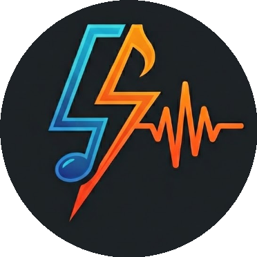
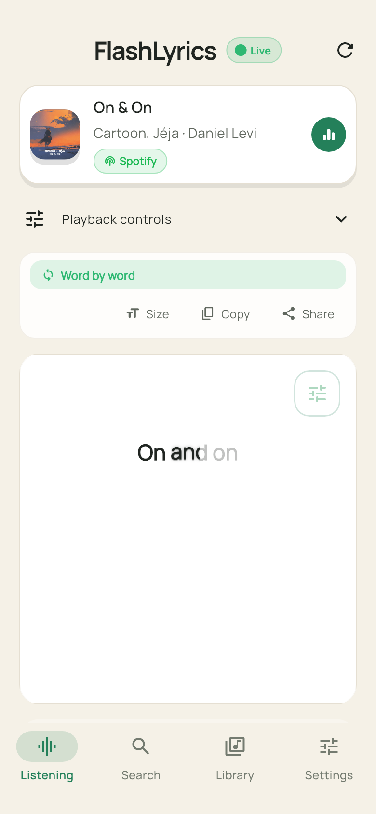
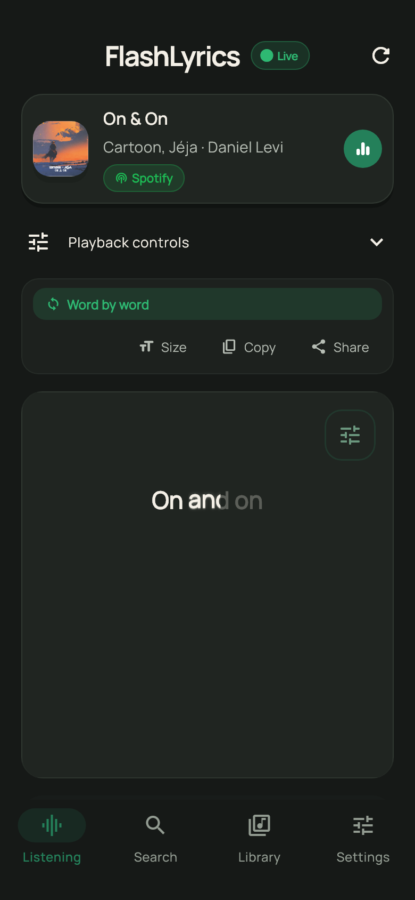
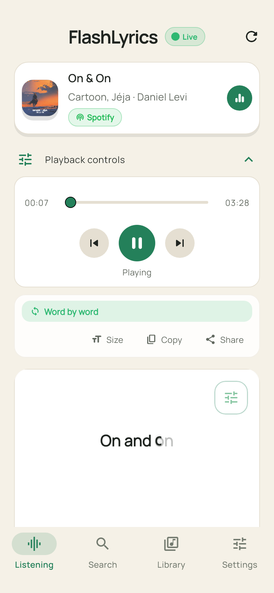

<p align="center">
  
</p>

<h1 align="center">FlashLyrics</h1>
<p align="center"><strong>Your music. Every word.</strong></p>
<p align="center">Lyrics that follow what you’re listening to, across your Android music apps.</p>

<p align="center">
  <a href="https://github.com/Avaneesh-Inamdar/FlashLyrics/releases/latest"></a>
  <a href="https://github.com/Avaneesh-Inamdar/FlashLyrics/releases"></a>
  
</p>

<p align="center">
  <a href="https://play.google.com/store/apps/details?id=music.flashlyrics.app"></a>
  &nbsp;
  <a href="https://github.com/Avaneesh-Inamdar/FlashLyrics/releases/latest"></a>
  &nbsp;
  <a href="https://github.com/Avaneesh-Inamdar/FlashLyrics/issues/new"></a>
</p>

---

FlashLyrics reads the track information shared by your music player and finds the lyrics for you. Follow along in the app, keep lyrics above other apps with the floating window, or revisit saved songs offline.

## A closer look

<table>
  <tr><th>Listening · light</th><th>Listening · dark</th><th>Playback controls</th></tr>
  <tr>
    <td></td>
    <td></td>
    <td></td>
  </tr>
</table>

<sub>Current app renders featuring NCS tracks and the official On & On cover artwork. The short lyric excerpt uses illustrative word timings. [Capture details and artwork credits](docs/screenshots/README.md).</sub>

## Built for listening

| Feature | What you get |
| --- | --- |
| Automatic detection | Track and artist information from compatible Android media sessions. |
| Word-by-word lyrics | Progressive fill, subtle lift and glow when genuine word timestamps are available. |
| Synced lyrics | Automatic line scrolling, tap-to-seek, and timing adjustments. |
| Floating window | Lyrics above your music player, with resizing and optional seeking. |
| Offline library | Previously fetched lyrics saved on your device. |
| Manual search | Search by song or artist, choose a result, and explore Genius for harder-to-find tracks. |
| Sharing | Share selected lyrics as text or a styled image. |
| Personalization | Light, dark or system theme; accent colors; adjustable text size. |

### Timing that matches the available lyrics

FlashLyrics supports **word timed**, **line synced**, and **plain text** lyrics. Lyrics appear before an optional background lookup checks for matching word timestamps; a successful match upgrades the display and is cached.

For songs with line timestamps only, the optional **Karaoke** button previews a word animation within each line. The app labels this as **estimated timing**. Those estimates are never saved as genuine provider timestamps. Word timing and song coverage vary by source.

## Get started

1. Install from [Google Play](https://play.google.com/store/apps/details?id=music.flashlyrics.app) or choose the `.apk` asset on [GitHub Releases](https://github.com/Avaneesh-Inamdar/FlashLyrics/releases/latest).
2. Grant **Notification Access** when prompted so FlashLyrics can detect the current track.
3. Play music in your usual player and open the **Listening** tab.
4. To use floating lyrics, allow **Display over other apps**, expand the FlashLyrics notification, and tap **Float**. You can revisit the instructions in Settings.

Spotify, YouTube Music, Apple Music and other Android players can work when they expose media-session metadata. Detection, position updates and seeking depend on the player’s support.

**Upgrading from 1.2.0 or earlier?** Those builds used a different signing key. Uninstall the old build before installing the current release; uninstalling also removes locally saved lyrics and settings.

## What’s new

The current source is **1.4.3**. Published downloads are listed on the release page; Google Play availability follows its release rollout.

- Animated word highlighting with optional background timing upgrades.
- Saved karaoke preference across songs and app restarts.
- Native notification tracking and a matching-lyrics fallback when the main app is closed.
- A compact listening screen with collapsible playback controls.
- Search results can appear while slower providers are still responding.
- Google Play update checks and notification guidance in Settings.
- Refined Android edge-to-edge handling and lyrics layouts.

See the [1.4.3 release notes](RELEASE-1.4.3.md) for validation and device-testing limitations.

## Lyrics sources

| Source | Used for |
| --- | --- |
| [LRCLIB](https://lrclib.net) | Line timestamps, word timestamps where available, and plain lyrics. |
| [Textyl](https://textyl.co) | An additional synced-lyrics source. |
| [ChartLyrics](https://www.chartlyrics.com) | Plain-text lyrics. |
| [Lyrics.ovh](https://lyrics.ovh) | Plain-text fallback. |
| [Lyrist](https://github.com/asrvd/lyrist) | An additional plain-text fallback. |
| [NetEase Music](https://music.163.com) | Additional song coverage and synced lyrics where available. |
| [Genius](https://genius.com) | Matching web lyrics for niche songs, with a dedicated manual lookup. |

Results depend on provider availability and matching metadata. Lyrics belong to their respective rights holders; FlashLyrics does not create missing lyrics or timestamps.

## Permissions and storage

**Notification Access** enables music detection. **Display over other apps** enables the floating window. Android notification permission allows the app’s playback notification where required.

Fetched lyrics and preferences are stored locally. Online lyric lookup sends song or search information to the selected providers. Banner advertising is optional and can be disabled in Settings.

## Build from source

Use a compatible Flutter SDK with **Dart 3.11 or later**, the Android SDK, and the JDK required by the Android Gradle plugin.

```sh
git clone https://github.com/Avaneesh-Inamdar/FlashLyrics.git
cd FlashLyrics
flutter pub get
flutter run
```

Run the checks and build a debug APK:

```sh
flutter analyze
flutter test
flutter build apk --debug
```

Release builds require your own Android signing configuration in `android/key.properties` and its referenced keystore. Signing files are excluded from version control.

```sh
flutter build apk --release
flutter build appbundle --release
```

The app uses Flutter and Riverpod with native Android media-session and floating-window integration. Screen widgets live in `lib/presentation`, lyric providers and caching in `lib/data`, and Android integrations in `android`.

## Feedback and support

Found a mismatch or a detection problem? [Open an issue](https://github.com/Avaneesh-Inamdar/FlashLyrics/issues) with the app version, Android version, music player, song and artist, and steps to reproduce it.

If FlashLyrics makes your listening better, you can [support development](https://buymeacoffee.com/avaneeshinamdar).

<sub>The download badge counts `.apk` asset downloads from public GitHub Releases, not unique users or Google Play installs. It refreshes periodically through [GitHub Actions](.github/workflows/apk-downloads.yml).</sub>
